# SoC Error Pin: End-to-End Platform and OpenBMC Design

**Date:** October 23, 2026

## Purpose

Define the proposed end-to-end fatal-error flow using the platform-level Rolas
fault/alert diagram and the OpenBMC GPIO/SGPIO implementation model.  This
document separates the electrical-safety paths that must act in hardware from
the BMC-managed RAS path that captures evidence before host recovery.

Related notes:

- `SOC_ERROR_PIN_RAS_OPENBMC_NOTE.md` — RAS ownership, CPER, BERT, and
  recovery policy.
- `SOC_ERROR_PIN_GPIO_SGPIO_OPENBMC_NOTE.md` — Linux GPIO, SGPIO, and FPGA
  exposure choices.
- `PHOSPHOR_MULTI_GPIO_MONITOR_OPENBMC_NOTE.md` — monitor operation and
  existing upstream platform examples.

## Platform Diagram Interpretation

The supplied Rolas diagram establishes these hardware domains:

```text
Rolas / VRs / DRAM / platform thermal sources
  -> HPM FPGA
  -> LTPI
  -> SCM FPGA
  -> BMC interface labelled "SGPIO (Alerts/Faults)"
```

It also shows BMC I2C connectivity and FPGA-mediated controls.  For this
platform, it supports a two-part BMC interface:

1. **SGPIO alert/fault input bits** provide low-latency notification to the
   BMC.  The SoC fatal source must occupy a designated bit, for example
   `SCM_SOC_FATAL`.
2. **FPGA status/control registers** provide source identity, sticky status,
   LTPI health, masking, and acknowledgement.

The SGPIO label is the intended notification transport.  The board-level FPGA
and device-tree contracts must still confirm the exact SGPIO input bit, line
name, active polarity, interrupt behavior, and whether the upstream ASPEED
SGPIO driver owns it.

## Signal Classification

The Rolas diagram must not be collapsed into one generic fatal-error path.

| Signal family shown in diagram | Default response | BMC role | Fatal CPER/BERT trigger? |
| --- | --- | --- | --- |
| `VRHOT`, `ROPHOT`, `MEMHOT` / `DIMHOT`, `AVS_ALERT`, `PMBUS_ALERT` | Throttle, sensor, VR, or power-management action | Telemetry, policy, and logging | No by default. |
| `EMERGENCY` | Immediate hardware protection/throttling | Capture outcome after safety action | No default BMC-dependent reset; hardware acts first. |
| `SOCHOT` | Graceful host shutdown | Request/observe shutdown and log | No by default. |
| `THERMTRIP` | FPGA-initiated ungraceful S0-to-S5 shutdown | Record available status after safety action | No by default. |
| `PS_HOLD` | Warm reset in the diagram | Candidate only after source/reason validation | Possibly; do not assume it equals `SOCERR`. |
| Dedicated `SOCERR` / SoC fatal source | Sticky capture then configured recovery | Full out-of-band RAS workflow | Yes, when platform contract designates it. |

`EMERGENCY` and `THERMTRIP` must remain electrically safe even if LTPI, the
SCM FPGA, the BMC kernel, or OpenBMC userspace is unavailable.

## Required Hardware Contract

The diagram leaves the following items open.  They must be specified before
OpenBMC integration:

1. **Fatal source definition:** identify whether the feature trigger is a
   dedicated `SOCERR` source, a qualified `PS_HOLD` reason, or another signal.
   Do not use `PS_HOLD` as a proxy for fatal RAS until the ASIC/FPGA contract
   confirms that it uniquely represents the requested fatal condition.
2. **Source preservation:** HPM and SCM FPGA status must retain the original
   source/reason rather than OR-ing unrelated thermal, VR, and fatal sources
   into one unqualified alert.
3. **Sticky retention:** the HPM/SCM fatal state and the BMC-visible alert must
   survive a short input pulse and a BMC service restart until explicitly
   acknowledged.
4. **BMC notification:** allocate and document a named SGPIO input line, such
   as `SCM_SOC_FATAL`, or document a common FPGA `ALERT#` input that wakes an
   FPGA event service.
5. **Status/control access:** define how the BMC reads SCM/HPM status and
   LTPI health, and how it masks, clears, and acknowledges every latch.
6. **Ordering:** reads must not clear evidence; the BMC acknowledges only
   after incident data is durably persisted.
7. **Warm-reset semantics:** define which reset keeps the required SoC RAS
   registers sticky long enough for collection and host-firmware handoff.

## End-to-End Design Block Diagram

```mermaid
flowchart LR
    subgraph FAULTS[Platform fault and alert sources]
        SOC["SoC / chiplet fatal source<br/>Dedicated SOCERR or qualified PS_HOLD"]
        CXL["External CXL viral / RAS state"]
        ROLAS["Rolas alerts<br/>VRHOT, ROPHOT, MEMHOT, EMERGENCY"]
        THERM["Platform thermal, DRAM, VR, PMBus"]
    end

    subgraph HPM[Host Processor Module]
        HPMFPGA["HPM FPGA<br/>Capture source + sticky reason"]
    end

    subgraph SCM[Server Control Module]
        LTPI["LTPI termination"]
        SCMFPGA["SCM FPGA<br/>Sticky incident + LTPI health<br/>Mask / acknowledge control"]
    end

    subgraph BMC[OpenBMC / BMC]
        SGPIO["BMC SGPIO controller<br/>Upstream GPIO driver and IRQ"]
        REG["SCM/HPM FPGA management registers<br/>Read status; write mask, ack, and clear<br/>I2C / MMIO / mailbox"]
        KERNEL["Linux gpiochip line<br/>SCM_SOC_FATAL"]
        MON["phosphor-multi-gpio-monitor<br/>SGPIO notification path"]
        HANDLER["soc-fatal-handler@0.service<br/>Single-flight incident workflow"]
        LOG["Event log + raw CPER artifact<br/>Persistent BERT handoff record"]
        RECOVERY["OpenBMC host-state action<br/>Force warm reboot or escalation"]
    end

    FWHOST["Host firmware on next boot<br/>Consumes record and creates ACPI BERT"]

    SOC --> HPMFPGA
    CXL --> HPMFPGA
    ROLAS --> HPMFPGA
    THERM --> HPMFPGA
    HPMFPGA --> LTPI --> SCMFPGA

    SCMFPGA -->|SOCERR SGPIO input bit| SGPIO
    SGPIO --> KERNEL
    KERNEL --> MON
    MON --> HANDLER
    SCMFPGA -->|"sticky status and source"| REG
    REG -->|"snapshot result"| HANDLER
    HANDLER -->|"ack / clear after persistence"| REG
    HANDLER --> LOG
    LOG --> FWHOST
    HANDLER --> RECOVERY
```



This platform design has no shared FPGA `ALERT#` detector branch.  The FPGA
asserts a designated `SOCERR` SGPIO input bit, which the Linux SGPIO driver
exposes as one GPIO line.  The FPGA management registers remain available to
`soc-fatal-handler` for source validation, evidence collection, and
acknowledgement; they do not replace the SGPIO notification line.

The handler first reads the sticky snapshot through the management-register
interface.  After it durably persists the incident, it writes the documented
acknowledge or clear control.  That write permits the FPGA to clear the
captured incident latch and deassert the SGPIO notification; it must not occur
before the capture is safely stored.

## Preferred SGPIO-Based OpenBMC Path

When the SCM FPGA drives the fatal indication into an ASPEED SGPIO input that
is exported by the upstream driver, the preferred path is:

```text
SCM FPGA sticky SOCERR
  -> named ASPEED SGPIO input, SCM_SOC_FATAL
  -> upstream ASPEED SGPIO GPIO interrupt
  -> Linux gpiochip event
  -> phosphor-multi-gpio-monitor
  -> systemd StartUnit(soc-fatal-handler@0.service)
  -> read FPGA status and preserve incident
```

The SGPIO line is the notification path only.  The handler must treat the
SCM/HPM FPGA sticky registers, LTPI state, and SoC/CXL collection results as
the authoritative incident evidence.

Use a `LineName`-based monitor configuration after the hardware contract
defines its real line name, polarity, and logical assertion edge.  The final
configuration must include an initial-state reconciliation target so a fatal
incident retained during a BMC restart is not missed.

## Fatal Incident Sequence

```text
1. SoC fatal source asserts.
2. HPM FPGA latches source identity and relevant status.
3. LTPI forwards the incident; SCM FPGA latches source and link state.
4. SCM FPGA asserts the designated BMC `SOCERR` SGPIO input bit.
5. Kernel delivers the GPIO interrupt/event.
6. Detector starts soc-fatal-handler@0.service.
7. Handler acquires an incident lock and reads SCM/HPM/LTPI/SoC/CXL evidence.
8. Handler persists BMC log, raw CPER, manifest/checksum, and BERT handoff.
9. Handler acknowledges/unmasks FPGA latches in the documented order.
10. Handler requests the configured warm reboot or safety escalation.
11. Host firmware consumes the persisted record and constructs BERT.
```

If any remote source is unavailable, the handler records a partial capture and
the reason.  It must not suppress the local BMC event log or claim a clean
incident.

## Existing Versus Proposed Components

| Component | Status | Design use |
| --- | --- | --- |
| Upstream ASPEED SGPIO GPIO/IRQ support | Existing upstream kernel capability | Detect a named SGPIO input when the hardware maps the fatal signal to it. |
| `phosphor-multi-gpio-monitor` | Existing OpenBMC component | Convert an SGPIO GPIO edge into a systemd service start. |
| Existing Rainier and Ampere monitor configurations | Existing platform references | Reuse their monitor-to-service pattern, not their direct reset policy. |
| `soc-fatal-handler@0.service` | Proposed platform service | Capture, persist, acknowledge, and recover in the required order. |
| FPGA sticky source/status contract | Platform hardware work | Preserve root-cause identity across HPM, LTPI, SCM, and BMC restart. |
| CPER/BERT transfer mechanism | Platform-specific design work | Make the persisted artifact available to host firmware after recovery. |

## Review Checklist

Before implementation approval, close these questions:

- Is the intended trigger `SOCERR`, qualified `PS_HOLD`, or another source?
- Which signals in the Rolas table are telemetry, hardware safety, graceful
  shutdown, or fatal-RAS triggers?
- Which physical SGPIO input bit carries the fatal notification?
- Does the existing upstream SGPIO driver expose that input with the required
  interrupt semantics and a stable line name?
- Where are SCM/HPM sticky status, LTPI health, clear, mask, and acknowledge
  registers defined?
- Can the BMC read the status before either FPGA clears it?
- What reset type preserves the required SoC evidence?
- What is the exact host-firmware handoff mechanism and consumption
  acknowledgement for the CPER artifact?
